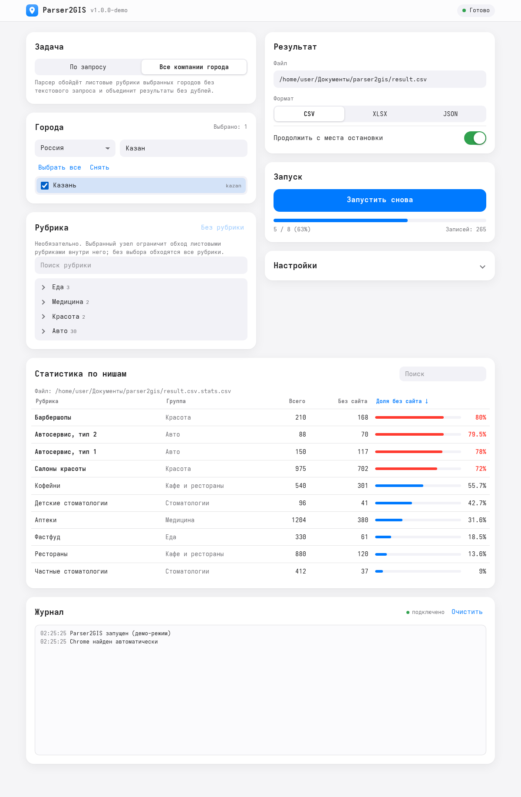

<p align="center">
  
</p>
<h1 align="center">Parser2GIS</h1>
<p align="center"><b>Форк</b> <a href="https://github.com/interlark/parser-2gis">interlark/parser-2gis</a>: обход всех компаний города, статистика по нишам и веб-интерфейс</p>

**Parser2GIS** — парсер сайта [2GIS](https://2gis.ru/) с помощью браузера [Google Chrome](https://google.com/chrome).
Авторство оригинального проекта и лицензия (LGPL-3.0) сохранены, подробнее — в разделе [Благодарности и лицензия](#-благодарности-и-лицензия).

<p align="center">
  <picture>
    <source media="(prefers-color-scheme: dark)" srcset="docs/images/web-dark.png">
    
  </picture>
</p>
<p align="center"><sub>Веб-интерфейс в демо-режиме (<code>?mock=1</code>): цифры в таблице статистики вымышленные.</sub></p>

## ℹ️ Описание

Парсер для автоматического сбора базы адресов и контактов предприятий, которые работают на территории
России , Казахстана , Беларуси ,
Азербайджана , Киргизии , Узбекистана , Чехии , Египта , Италии , Саудовской Аравии , Кипра , Объединенных Арабских Эмиратов , Чили , Катара , Омана , Бахрейна , Кувейта .

## 🆕 Что нового в форке

| Возможность | Как пользоваться |
|---|---|
| **Обход всех компаний города без запроса** | `parser-2gis --city kazan -o result.csv -f csv` |
| **Колонки «Есть сайт», «Коды рубрик», «Рубрика обхода»** | включаются сами в режиме `--city` |
| **Статистика по нишам**: доля компаний без сайта по каждой рубрике | `<результат>.stats.csv` или лист «Статистика» в XLSX |
| **Чекпоинт и возобновление** обхода | повторный запуск продолжает, `--no-resume` — начать заново |
| **Устойчивость**: повтор упавшей рубрики, остановка на капче | автоматически |
| **Веб-интерфейс** | `parser-2gis --web` |
| **Режим «Все компании города» в десктопном GUI** | чекбокс в генераторе ссылок |

## ✨ Особенности
- 💰 Бесплатный, без регистрации и ключей API
- 🖥️ Работает под Windows, Linux и macOS
- 📄 Три выходных формата: CSV, XLSX и JSON
- 🔗 Генератор ссылок по городам и рубрикам (GUI и веб-интерфейс)
- 🧭 Обход города по ~1650 листовым рубрикам 2GIS, дубли убираются
- 📊 Сводка «где чаще всего нет сайта»: по узким нишам («Частные стоматологии», «Организация похорон»), а не по «Медицине» целиком

## 🚀 Установка
> Для работы парсера необходим браузер [Google Chrome](https://google.com/chrome) или Chromium. Парсер ищет их сам: сначала Chrome, затем Chromium (`chromium`, `chromium-browser`, в том числе `/snap/bin`), на Linux в крайнем случае Chromium, скачанный Playwright (`~/.cache/ms-playwright`). Если браузер лежит в другом месте, укажите его: `--chrome.binary_path /путь/к/браузеру` (в веб-интерфейсе — «Путь к Chrome» в настройках).
>
> Arch Linux: `sudo pacman -S chromium` (Chrome есть только в AUR).

Форк не публикуется в PyPI и не имеет готовых сборок: ставьте из исходников (Python 3.8+).

```bash
git clone https://github.com/aloesc/parser-2gis-web.git
cd parser-2gis-web
python -m venv venv && source venv/bin/activate      # Windows: venv\Scripts\activate
pip install -e .            # CLI и веб-интерфейс
pip install -e .[gui]       # + десктопный GUI (см. примечание ниже)
```

> **Примечание про GUI.** `setup.py` закрепляет `PySimpleGUI==4.59.0`, но эта версия больше недоступна в PyPI. Веб-интерфейс и CLI на неё не опираются; для десктопного GUI поставьте доступную 4.x вручную (например, `pip install PySimpleGUI==4.60.5.1`). Совместимость с ней в форке не проверялась.

Одним исполняемым файлом (нужны dev-зависимости, `pip install -e .[dev]`):

```bash
python setup.py build_standalone      # результат в dist/Parser2GIS
```

## ⚡ Быстрый старт

```bash
# Веб-интерфейс (откроется браузер, http://127.0.0.1:8765)
parser-2gis --web

# Все компании Казани по всем листовым рубрикам
parser-2gis --city kazan -o ~/kazan.csv -f csv

# Только нужные рубрики (по одному коду на строку)
parser-2gis --city kazan moscow --rubrics-file rubrics.txt -o result.xlsx -f xlsx

# Как в оригинале: по готовой ссылке на выдачу
parser-2gis -i "https://2gis.ru/kazan/search/Ритуальные услуги" -o out.csv -f csv

# Десктопный GUI (если установлен PySimpleGUI): без аргументов
parser-2gis
```

Полный список параметров — `parser-2gis --help`.

## 🧭 Обход города

`--city` принимает один или несколько кодов городов из [`parser_2gis/data/cities.json`](parser_2gis/data/cities.json) (поле `code`, например `kazan`, `moscow`, `spb`). Для каждой листовой рубрики из [`rubrics.json`](parser_2gis/data/rubrics.json) открывается выдача `https://2gis.<домен>/<город>/search/x/rubricId/<код>` и собираются карточки компаний.

- **Своя выборка рубрик:** `--rubrics-file` — текстовый файл, по одному коду рубрики на строку, пустые строки и `# комментарии` пропускаются. В веб-интерфейсе и GUI можно выбрать узел дерева рубрик: обойдутся листья внутри него.
- **Дубли:** компания, найденная в нескольких рубриках, записывается один раз (сравнивается устойчивая часть id из API).
- **Чекпоинт:** рядом с результатом создаётся `<результат>.checkpoint.json`. Если обход прервали (стоп, капча, закрытая вкладка), повторный запуск той же командой продолжит с места остановки. `--no-resume` начинает заново.
- **Файлы при возобновлении:** писатель открывает файл заново, поэтому прежний результат переносится в `<результат>.part1`, `.part2`, …, а новый файл содержит остаток. Статистика считается по всем частям вместе. Режима дозаписи пока нет.
- **Сбои:** если рубрика зависла или упала, она повторяется ещё дважды (паузы 5 и 15 с), затем пропускается, а обход идёт дальше. Пропущенные рубрики остаются в чекпоинте и добираются при следующем запуске с возобновлением.
- **Капча:** парсер **не решает** капчу. При редиректе на `captcha.2gis.ru` обход останавливается с сообщением, прогресс сохраняется. Пройдите капчу в браузере (или смените IP/сеть) и запустите команду снова.
- **Пустые рубрики** 2GIS возвращает как «Не найдено», они пропускаются быстро.
- **Ограничение выдачи:** 2GIS отдаёт по одной рубрике ограниченное число страниц. Крупные рубрики большого города (аптеки, салоны красоты в Москве) могут оказаться неполными; разбиение по районам пока не реализовано.
- **Нагрузка:** это сотни запросов на город. Используйте `--parser.delay_between_clicks`, не запускайте несколько обходов параллельно и соблюдайте условия использования 2GIS.

## 📊 Колонки и статистика

В режиме `--city` автоматически включаются колонки:

| Колонка | Содержимое |
|---|---|
| `Веб-сайт 1…N` | ссылки на сайты (как и в оригинале) |
| `Есть сайт` | `да`/`нет`, считается **только** по контакту типа `website` (соцсети не в счёт) |
| `Рубрики` | все рубрики компании из ответа 2GIS |
| `Коды рубрик` | id этих рубрик, в том же порядке |
| `Рубрика обхода` | код рубрики, по выдаче которой компания найдена |

После обхода создаётся сводка (для CSV — `<результат>.stats.csv`, для XLSX — лист «Статистика»; для JSON сводка не строится):

| Рубрика | Группа | Всего | Без сайта | Доля без сайта |
|---|---|---|---|---|
| … | … | … | … | … |

- Статистика строится **по листовым рубрикам**, поэтому «Частные стоматологии» и «Больницы» — разные строки. Колонка «Группа» — родительская рубрика из `rubrics.json`.
- Компания с несколькими рубриками учитывается в каждой из них. Если у записи нет рубрик в ответе API, она относится к рубрике обхода.
- Сортировка: по убыванию доли без сайта, затем по числу компаний.
- В режиме `-i` эти колонки не добавляются автоматически; их можно включить в настройках веб-интерфейса.
- 2GIS показывает первыми заметные компании, поэтому выборка «первые N записей» занижает долю без сайта. Для честной цифры обходите рубрики целиком.

## 🌐 Веб-интерфейс

```bash
parser-2gis --web [--port 8765] [--no-browser]
```

Локальный сервер на стандартной библиотеке Python, без новых зависимостей. Браузер открывается автоматически (`--no-browser` отключает), при занятом порте берётся следующий свободный.

- **Что есть:** режимы «По запросу» и «Все компании города», выбор стран/городов с поиском, дерево рубрик, путь и формат результата, настройки Chrome/парсера/записи, запуск, остановка, прогресс, живой журнал, таблица статистики с сортировкой. Светлая и тёмная темы.
- **Безопасность:** сервер слушает только `127.0.0.1`; все изменяющие запросы требуют токен (выдаётся странице при загрузке), запросы с чужим `Host`/`Origin` отклоняются. Результат пишется только по пути, который вы указали сами. Не пробрасывайте порт наружу.
- **Задача одна:** пока идёт обход, вторую запустить нельзя. «Продолжить с места остановки» включено по умолчанию.
- Браузер Chrome запускается на той же машине, где работает сервер.

## 🛠️ Разработка

```bash
pip install -e .[dev]
pytest -v --ignore=tests/test_parser.py     # быстрые тесты без сети и Chrome
flake8 parser_2gis tests                    # max-line-length 130
```

- `tests/test_parser.py` — интеграционный: открывает Chrome и ходит на `2gis.ru`.
- `tox` запускает flake8, mypy и pytest; закреплённый `mypy==0.950` не запускается на новых версиях Python, свежий `mypy` даёт три замечания, которые есть и в оригинале.
- Архитектура и подводные камни — в [`CLAUDE.md`](CLAUDE.md), контракт веб-API и решения — в [`SPEC.md`](SPEC.md).

## ⚠️ Известные ограничения
- Нет режима дозаписи: при возобновлении результат делится на части `.partN`.
- Капчу 2GIS пользователь проходит сам.
- Лимит выдачи по рубрике не обходится, крупные рубрики могут быть неполными.
- Десктопный GUI не проверялся в окне после доработок (нет подходящей версии PySimpleGUI в PyPI).

## 📖 Документация оригинала
Описание базовой работы парсера и настроек — на [вики оригинала](https://github.com/interlark/parser-2gis/wiki).

## 🙏 Благодарности и лицензия
Проект — форк [interlark/parser-2gis](https://github.com/interlark/parser-2gis), автор оригинала — Andy Trofimov. Все права на оригинальный код принадлежат его автору; изменения форка распространяются на тех же условиях — [GNU LGPL v3](LICENSE).
Если оригинальный проект был вам полезен, поддержать его автора можно на странице [оригинала](https://github.com/interlark/parser-2gis#-%D0%BF%D0%BE%D0%B4%D0%B4%D0%B5%D1%80%D0%B6%D0%B0%D1%82%D1%8C-%D0%BF%D1%80%D0%BE%D0%B5%D0%BA%D1%82).
